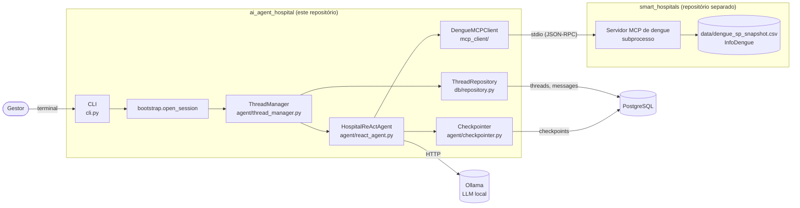
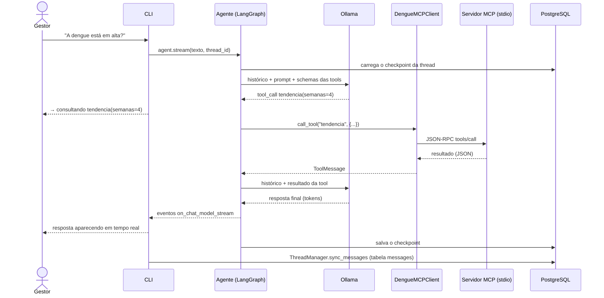

# Arquitetura

O `ai_agent_hospital` é um agente ReAct (raciocínio + ação) que responde perguntas de um gestor de
hospital sobre a dengue em São Paulo. Tudo roda localmente: o modelo de linguagem no Ollama, as
conversas no PostgreSQL e os dados num servidor MCP iniciado como subprocesso.

## Componentes

| Componente | Onde | Papel |
|---|---|---|
| CLI | `cli.py` | Comandos `chat`, `threads`, `history`, `fork`, `delete`, `health`; mostra a resposta em streaming |
| Montagem | `bootstrap.py` | `open_session` abre banco, checkpointer, Ollama e MCP e entrega um `ThreadManager` |
| Agente | `agent/react_agent.py` | Grafo ReAct (`langchain.agents.create_agent`) com o prompt de `agent/prompts.py` e middlewares de erro |
| LLM | `agent/llm.py` | `ChatOllama` (temperatura 0.1) e checagem de saúde do Ollama |
| Threads | `agent/thread_manager.py` | Mantém o catálogo de threads e o estado do grafo em acordo |
| Persistência | `db/`, `agent/checkpointer.py` | Pool psycopg 3, schema próprio e o `AsyncPostgresSaver` do LangGraph |
| Cliente MCP | `mcp_client/` | Sobe o servidor via stdio e converte as tools para o LangChain |
| Servidor MCP | repo [smart_hospitals](https://github.com/kajus9138/smart_hospitals) | Quatro tools de leitura sobre o snapshot do InfoDengue |

O servidor MCP é um sistema **externo**: tem repositório, dependências e ciclo de release próprios, e
o agente só conhece o comando para iniciá-lo. Detalhes em [mcp-integration.md](mcp-integration.md).

## Montagem e encerramento

`bootstrap.open_session(with_tools=True)` (usado pelo `chat`) abre os recursos nesta ordem:

1. **Ollama**: responde e tem o modelo baixado? É a checagem mais barata, então vem primeiro.
2. **PostgreSQL**: pool do repository e `init_schema` (idempotente).
3. **Checkpointer**: pool próprio (exige autocommit e `dict_row`) e `setup()` das tabelas do LangGraph.
4. **Servidor MCP**: sobe o subprocesso, faz o handshake e descobre as tools.
5. **Agente** com as tools e o checkpointer, embrulhado no `ThreadManager`.

Tudo fica num `AsyncExitStack` e fecha na ordem inversa, inclusive no Ctrl+C e no SIGTERM. Abertura e
fechamento acontecem na mesma task asyncio, exigência do transporte stdio do MCP. Os comandos que não
conversam (`threads`, `history`, `fork`, `delete`) usam `with_tools=False`: só o banco, sem Ollama
nem servidor MCP.

## O loop ReAct

Uma pergunta pode levar a várias idas ao modelo: ele decide se precisa de dados, chama uma ou mais
tools, lê os resultados e só então responde.

O modelo recebe os schemas das tools descobertos no servidor, não uma descrição escrita no prompt. O
prompt (`agent/prompts.py`) define o papel (apoio à decisão), o escopo dos dados (município de São
Paulo, sem leitos nem recorte por bairro) e as regras: citar a semana de referência, explicar o
raciocínio das recomendações e nunca inventar dados.

## Persistência das threads

Cada conversa é uma thread, guardada em dois lugares no mesmo PostgreSQL:

| Onde | Tabelas | Para quê |
|---|---|---|
| Catálogo (`db/schema.sql`) | `threads` (id, criação, metadados) e `messages` (role, content, tool_calls, `seq`) | Listar, mostrar histórico, contar; consultável com SQL simples |
| Checkpointer do LangGraph | `checkpoints`, `checkpoint_blobs`, `checkpoint_writes`, `checkpoint_migrations` | Estado completo do grafo, para retomar a conversa |

O UUID da thread no catálogo é o `thread_id` do grafo. A tabela `messages` espelha as mensagens do
estado do grafo **na mesma ordem**: a mensagem N de uma é a N da outra (`seq` garante a ordem mesmo
com timestamps iguais). As operações do `ThreadManager` preservam isso:

- **Turno**: ao fim de cada resposta (com sucesso ou não), `sync_messages` grava o que o estado tem a
  mais que a tabela. Se a tabela tiver mais mensagens que o estado, levanta `HistoryDivergedError` em
  vez de gravar desalinhado.
- **Turno interrompido**: uma tool cancelada ou que falhou deixaria uma chamada sem resposta no
  estado; `close_pending_tool_calls` a fecha com uma mensagem de erro, e a conversa segue.
- **Fork**: cria uma thread nova com as N primeiras mensagens. O corte só pode cair numa resposta
  final do assistente, para não deixar uma tool pendente nem duas perguntas seguidas.
- **Delete**: apaga o catálogo primeiro e depois os checkpoints. Se a segunda parte falhar, sobra só
  estado órfão, invisível nas listagens.

Como o estado vive no banco, `chat --thread <id>` retoma uma conversa depois de reiniciar a máquina.

## Erros e resiliência

Todos os erros esperados herdam de `AgentHospitalError` (`errors.py`), e cada mensagem diz o que
conferir. Na inicialização de um comando, a CLI mostra a mensagem e sai com código 1. Durante uma
conversa, o erro de um turno é mostrado e o `chat` continua aberto: o histórico até ali fica salvo e
a próxima pergunta pode funcionar (com o servidor MCP fora, não vai: saia e retome a thread).

| Erro | Quando |
|---|---|
| `OllamaConnectionError` | Ollama fora do ar ou modelo não baixado; ou falha transitória que sobrou das novas tentativas |
| `DatabaseConnectionError` | PostgreSQL inacessível na abertura do pool ou do checkpointer |
| `MCPConnectionError` | Configuração inválida ou servidor que não sobe |
| `ToolExecutionError` | Tool que falha fora do protocolo (ex.: o servidor caiu) |

Novas tentativas:

- **Modelo**: cada chamada tem até 2 novas tentativas com backoff para erro de conexão, timeout ou
  HTTP 502/503/504 (`ModelRetryMiddleware`). O 500 fica de fora: no Ollama costuma ser permanente,
  como falta de memória para o modelo.
- **Servidor MCP**: 3 tentativas na abertura (1 s, 2 s), 30 s de handshake cada. Sem reconexão no meio
  da conversa.
- **Banco**: o próprio pool reconecta com backoff até o timeout de 10 s.

Erros que a tool devolve pelo protocolo (argumento inválido, por exemplo) não são exceções: voltam ao
modelo como resposta da tool, para ele se corrigir. O SIGTERM (ex.: `kill`) fecha pools e o servidor
MCP antes de sair, com código 143.

`uv run ai-agent-hospital health` verifica os três serviços em paralelo e sai com 1 se algum estiver
fora.
